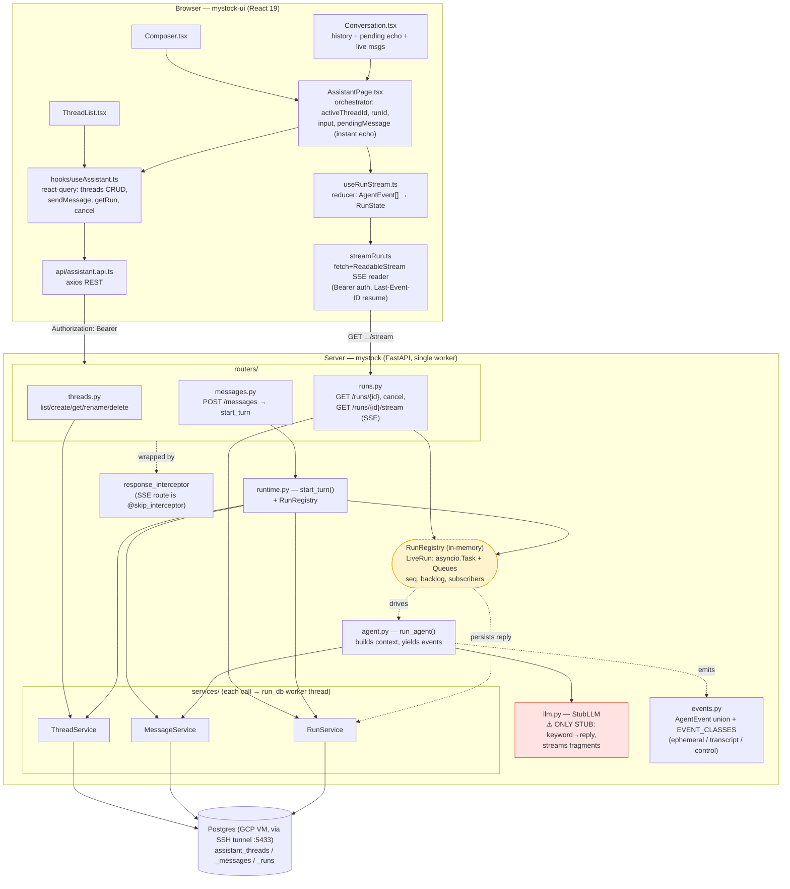
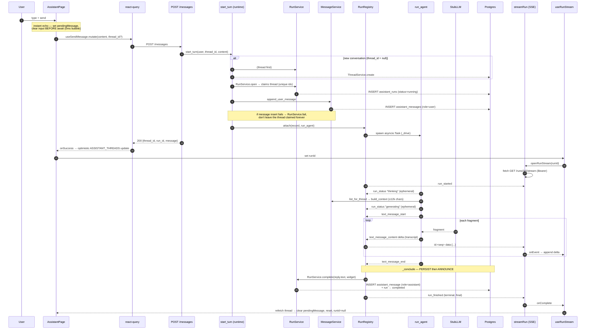
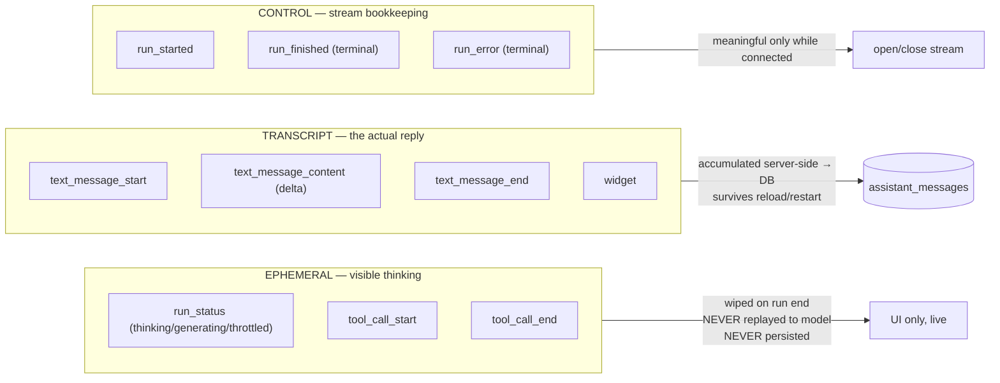
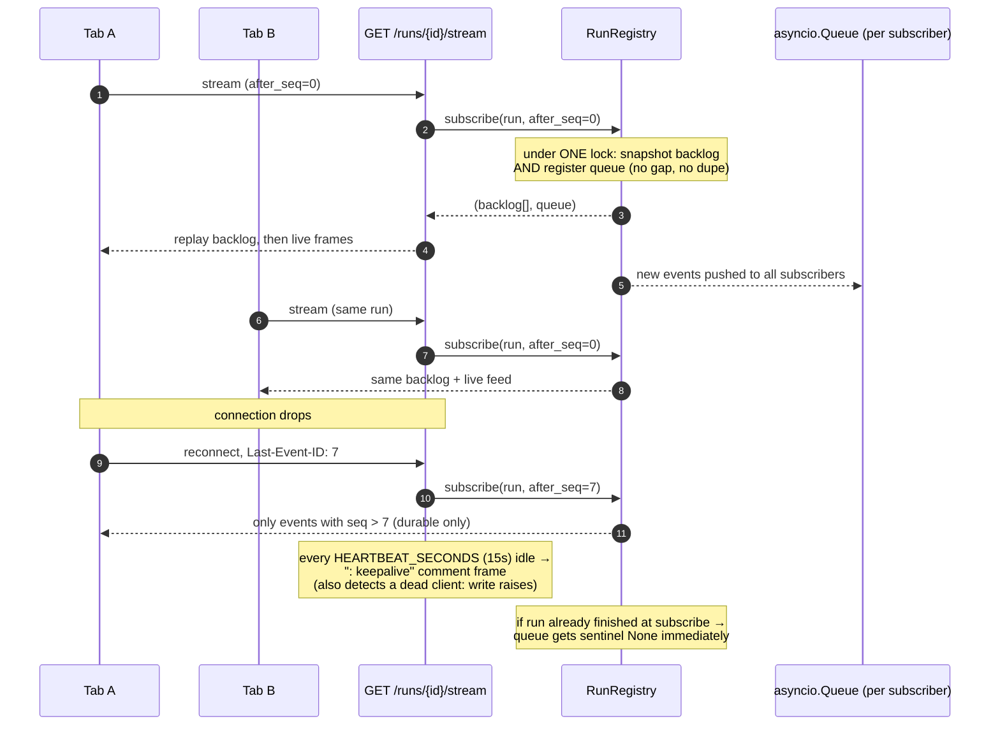
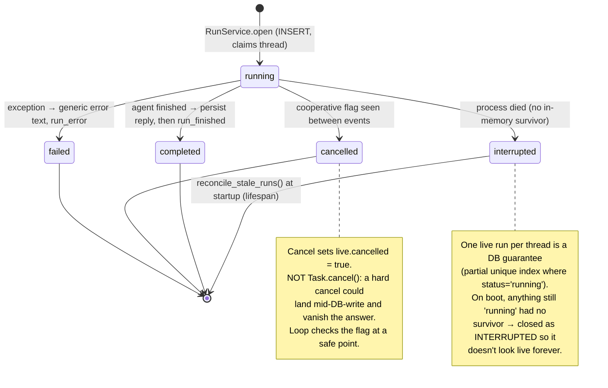
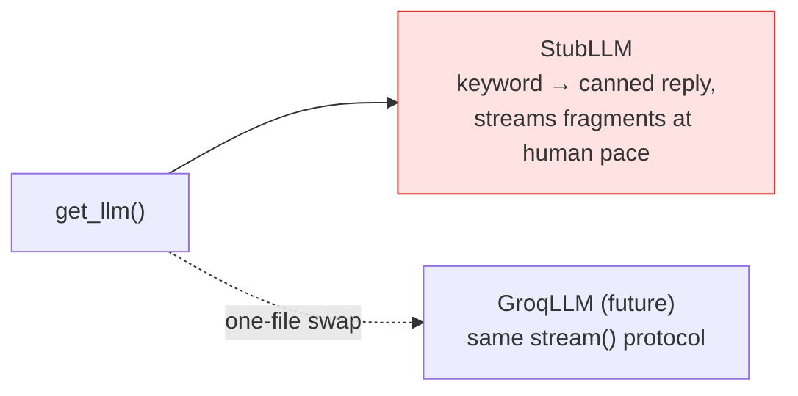

# Assistant — Pre-LLM Agentic Architecture

The agent surface is built end-to-end **except the model itself**. Persistence,
streaming, cancellation, reconnect, and crash recovery are all real; `llm.py` is
the single stub. Swapping `StubLLM` for a real client (e.g. Groq) is a one-file
change behind `get_llm()`.

This document describes exactly what exists today.

---

## 1. Component map

How the pieces fit together, from the browser down to Postgres. The dashed
registry is **in-process, in-memory** state — it is the "live" half of a run and
is deliberately *not* a database row.

---

## 2. The one-turn flow (send → answer)

This is the heart of the design. The POST returns **as soon as the run exists**,
*before* any token is generated; the browser then opens the SSE stream with the
returned `run_id`. Note the deliberate ordering in `start_turn`: **open the run
first** (that's what atomically claims the thread via the partial unique index),
*then* append the user message.

**Why persist-before-announce:** a client that sees `run_finished` may reload
instantly. If the DB write were still in flight, the answer it just watched
appear would be missing. The window is milliseconds on a local DB — which is
exactly why it survives testing and breaks in production.

---

## 3. Event classes — what survives the run

Every event is exactly one of three classes (`EVENT_CLASSES`, enforced at import
time against the `AgentEvent` union). This is the rule that keeps the agent's own
thinking out of its future input.

Two consequences that matter:
1. **The UI discards ephemerals when the run ends**, so a thread reads identically
   whether you watched it live or opened it an hour later (`useRunStream` drops
   `statusLabel`/`toolCalls` on terminal).
2. **Ephemerals are never fed back to the model.** `agent.py` builds context only
   from persisted `assistant_messages` (roles `user`/`assistant` only) — there is
   no path by which a status line can reach the prompt. On an ~8K TPM free tier,
   replaying "thinking…" would cost tokens to confuse the model.

---

## 4. Multi-tab watching + reconnect/resume

Any number of tabs can watch one run; each gets a backlog from its resume point
plus a live feed. Resume is by `Last-Event-ID` (the browser sets it on reconnect),
and the registry replays **durable events only** — so a client that drops and
returns sees the same transcript as one that never left.

**Backlog is capped** (`MAX_BACKLOG_EVENTS = 2000`) so a long run can't grow
unbounded; the terminal event is always delivered regardless.

---

## 5. Lifecycle, cancellation & crash recovery

A run's *liveness* lives in memory (`LiveRun` = `asyncio.Task` + queues); its
*record* lives in Postgres. That split is why `status` can be stale after a crash.

---

## 6. Key design invariants (read before changing anything)

| Invariant | Where enforced | Why |
|---|---|---|
| Persist reply **before** emitting terminal event | `runtime._conclude` | Client may reload on `run_finished`; the answer must already be in the DB. |
| Open run **before** appending user message | `runtime.start_turn` | The run row atomically claims the thread; message-first would store a question a rejected concurrent send can never answer. |
| One live run per thread | partial unique index `uq_assistant_runs_active_per_thread` | Makes "no concurrent runs" a DB guarantee, not a check-then-act race. Also what startup reconciliation scans. |
| Ephemerals never persisted / never replayed to model | `models.py` (2 roles only) + `agent.build_context` | Keeps the transcript stable across reloads; protects the token budget. |
| Cancellation is cooperative (flag, not `Task.cancel()`) | `runtime._drive` | A hard cancel could interrupt the DB write and vanish the answer. |
| SSE route skips the response interceptor | `@skip_interceptor` on `stream_run` | The interceptor buffers whole bodies; an endless stream would never reply. |
| `X-Accel-Buffering: no` on the stream | `runs.stream_run` | nginx buffers by default → whole answer arrives at once in prod only. |
| Message ordering by `id`, not `created_at` | `models.py` | PG `now()` is transaction-scoped; two rows in one txn share a timestamp. |
| Single worker only | `runtime.py` | Registry is process-local; scaling out needs Redis/Postgres pub-sub — this module is the only thing that changes. |

---

## 7. The only thing left to make it "real"

Everything else — the token-stream interface, correlation `message_id`,
cancellation between fragments, context budget (`MAX_CONTEXT_CHARS = 12_000`),
Indian-number system prompt — already assumes a real streaming model. The stub
has the *shape* of the real problem so the swap is just a new `LLM` class and a
changed `get_llm()` return.
